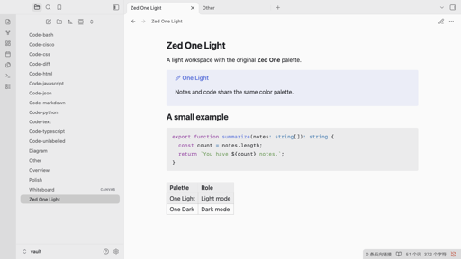

# Zed One Light & Dark

*The beauty of simplicity, in every shade.*

Bring Zed’s signature **One Light** and **One Dark** palettes to Obsidian.

From the restrained brightness of One Light to the quiet depth of One Dark, familiar colors bring text, space, light, and shade into balance.

The palette is understated, and the experience stays familiar. Every time you open a note, there’s a little more calm and delight.

**Preserve Obsidian’s original design and let color take center stage.**

Pair it with [Syntax Palette](https://github.com/bilibilijojo/obsidian-syntax-palette) to bring a little extra color to the code in your notes.

---

## Two palettes, two moods

- **One Light** feels clear and bright, with an easy simplicity.
- **One Dark** feels calm and soft, with a quiet depth.

Switch freely between light and dark while keeping a consistent visual language.

## Design philosophy

- Use Zed’s official One Light and One Dark palettes throughout.
- Apply the palettes to Obsidian’s editing and reading views and native interface.
- Preserve Obsidian’s typography, spacing, layout, and interactions.
- Follow Obsidian’s light and dark modes automatically.

## Installation

Requires **Obsidian 1.15.1** or later.

1. Download the [theme ZIP](https://github.com/bilibilijojo/zed-one-light-and-dark/releases/latest) and extract it.
2. Move the extracted theme folder into your vault’s `.obsidian/themes/` directory.
3. In Obsidian, go to **Settings → Appearance → Themes**.
4. Select **Zed One Light and Dark**.

In **Base color scheme**, choose **Light**, **Dark**, or **Adapt to system** to switch palettes.

## Acknowledgments

This theme draws its inspiration and colors from the official [Zed](https://zed.dev/) One palettes.

Thank you to the Zed team for the care they put into color and design.

## License

This is an independent Obsidian community theme. The original work is licensed under MIT, and the upstream Zed palettes retain their original MIT license. See [LICENSE](LICENSE) and [THIRD-PARTY-NOTICES.md](THIRD-PARTY-NOTICES.md) for details.
